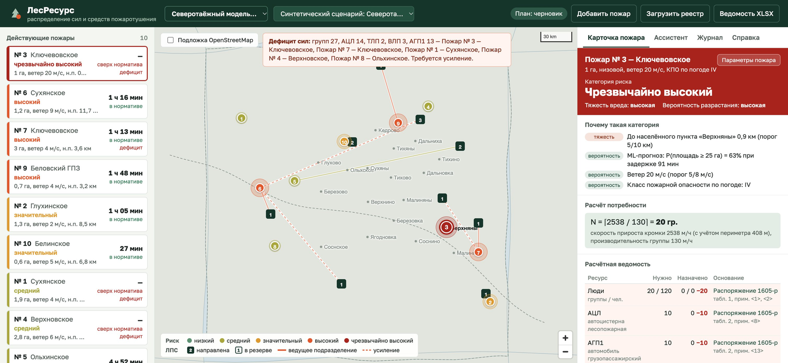

# ЛесРесурс — ИИ-ассистент распределения сил и средств пожаротушения (синтетический демонстрационный набор)

Прототип команды **«Корни Брянска»** для Лесного хакатона 2026 (трек № 1 «Прогнозирование, предотвращение и мониторинг лесных пожаров», задача 3 «Разработка интеллектуального ассистента поддержки принятия решений для оптимизации ресурсного обеспечения пожаротушения»).

Когда одновременно горит несколько лесных пожаров, ассистент помогает диспетчеру решить, куда направить людей и технику:
1. Определяет категорию риска каждого пожара.
2. Рассчитывает потребность в силах по нормативам Рослесхоза.
3. Распределяет ограниченный пул лесопожарных станций между всеми пожарами.
4. Формирует расчётную ведомость со ссылкой на пункт нормативного акта в каждой строке.

Решение принимает человек: план можно утвердить, изменить вручную или пересчитать.



## Происхождение данных: только синтетика

Этот репозиторий — **публичная демонстрационная версия** прототипа. Выгрузка реестра лесных пожаров, предоставленная организаторами хакатона, в него **не входит и не используется**: по требованию организаторов реестр нельзя публиковать и приводить в статьях. Поэтому весь набор данных здесь сгенерирован программно (`backend/etl/make_synthetic.py`, seed = 42):

- 14 210 записей за 2016–2025 годы в формате реестра лесных пожаров (37 колонок);
- четыре модельных субъекта с вымышленными названиями: **Северотаёжный модельный край**, **Лесостепная модельная область** (пилотные) и два фоновых — **Заозёрный модельный округ**, **Южнотаёжный модельный округ**;
- вымышленные лесничества, населённые пункты, ООПТ и дислокация станций; координаты лежат в условных границах субъектов и не соответствуют реальной местности;
- фоновая карта (границы, река) также генерируется процедурно (`backend/etl/make_basemap.py`), без данных Natural Earth и OpenStreetMap.

Синтетический набор воспроизводит структуру, которую ассистент использует: задержка начала тушения повышает вероятность разрастания до 25 га и более, крупные пожары дороже, пожары кластеризуются по времени и территории, станции испытывают дефицит сил. Доли и распределения подобраны так, чтобы они были близки к опубликованным агрегатам (доля пожаров ≥ 25 га ≈ 17 %, распределение задержки, медианные затраты), но **ни одна строка, название или координата не взяты из реального реестра**.

Метрики моделей и результаты симуляций поэтому отличаются от версии прототипа на реальных данных — сравнение приведено в [docs/METHODS_AND_RESULTS.md](docs/METHODS_AND_RESULTS.md).

---

## Содержание

- [Возможности](#возможности)
- [Быстрый старт](#быстрый-старт)
- [Как пользоваться](#как-пользоваться)
- [Настройка: LLM и маршруты](#настройка-llm-и-маршруты)
- [Разработка](#разработка)
- [Архитектура и методика](#архитектура-и-методика)
- [Данные и их пересборка](#данные-и-их-пересборка)
- [API](#api)
- [Результаты проверки](#результаты-проверки)
- [Допущения и ограничения](#допущения-и-ограничения)
- [Команда](#команда)

---

## Возможности

- **Градация риска.** Матрица 3×3 «тяжесть вреда × вероятность разрастания» даёт пять категорий: от низкого до чрезвычайно высокого. В карточке пожара видно, какие критерии сработали.
- **ML-прогноз (CatBoost)** вероятности того, что пожар разрастётся до 25 га и более, и ожидаемой итоговой площади в зависимости от задержки начала тушения.
- **Калькулятор потребности.** Число групп N = ⌈v/p⌉ × k. Техника: автоцистерны (АЦЛ), тракторы (ТЛП), бульдозеры (ТБ), вездеходы (ВЛП), транспорт (АГП1) — по распоряжению № 1605-р и Правилам тушения (приказ № 244), с удвоением сил по п. 52.
- **Оптимизатор (OR-Tools CP-SAT).** Минимизирует взвешенный ожидаемый ущерб при ограничениях «одно подразделение — один пожар», «силы ≥ потребности», «прибытие ≤ норматива п. 51» и с учётом резерва станций. Решение находится за доли секунды.
- **Сравнение с распределением «по очереди обнаружения» (FIFO)** по ожидаемому ущербу, доле крупных пожаров, площади, нарушениям норматива и дефициту.
- **Расчётная ведомость** в PDF и XLSX.
- **Ассистент-объяснитель.** Отвечает на вопросы вроде «почему эта станция», «где дефицит», «чем план лучше». Работает в шаблонном режиме или с LLM (GigaChat, YandexGPT, локальная модель). Числа в ответах LLM проверяются по расчёту: если в ответе есть число, которого нет в расчёте, ответ отклоняется (ФСТЭК № 117).
- **Загрузка обстановки** из файла в формате реестра лесных пожаров или ИСДМ-Рослесхоз (.xls, .xlsx) — парсер не привязан к синтетике и принимает любую выгрузку такого формата.
- **Журнал решений и архив утверждённых планов** в SQLite.
- **Офлайн-карта** с синтетической подложкой модельного субъекта и переключением на OpenStreetMap.

## Быстрый старт

Нужен **Python 3.10–3.12**. Node.js не нужен: собранный интерфейс уже лежит в `frontend/dist`.

### Windows

1. Установите Python с [python.org](https://www.python.org/downloads/); при установке отметьте **Add Python to PATH**.
2. Скачайте репозиторий (`Code → Download ZIP` или `git clone`) и распакуйте его.
3. Дважды щёлкните `run_windows.bat`.

Первый запуск создаёт окружение `backend\.venv` и ставит зависимости, это занимает 2–4 минуты. Затем открывается браузер на **http://localhost:8000**. Остановить сервер — `Ctrl+C` в окне консоли.

### Linux и macOS

```bash
git clone https://github.com/velvetway/lesresurs-synthetic.git
cd lesresurs-synthetic
./run.sh
# открыть http://localhost:8000
```

### Вручную

```bash
cd backend
python -m venv .venv
# Windows: .venv\Scripts\activate    Linux/macOS: source .venv/bin/activate
pip install -r requirements.txt
python -m uvicorn app.main:app --host 127.0.0.1 --port 8000
```

### Docker

```bash
docker compose up --build
# http://localhost:8000
```

Docker собирает и фронтенд, и бэкенд. Переменные окружения задаются в `docker-compose.yml`; пример — в `.env.example`.

## Как пользоваться

1. **Выберите регион** в шапке: Северотаёжный модельный край или Лесостепная модельная область. Откроется демо-сценарий синтетического набора — момент с наибольшим числом одновременно действовавших пожаров.
2. **Сценарий:** выпадающий список рядом с регионом содержит исторические моменты с тремя и более одновременными пожарами. Кнопка **«Загрузить реестр»** загружает обстановку из файла выгрузки (.xls или .xlsx, форма реестра лесных пожаров).
3. **Слева** — список пожаров с категориями риска и временем прибытия, пул ресурсов субъекта и сравнение с FIFO.
4. **На карте** — пожары (цвет означает категорию риска), станции и маршруты: сплошная линия — ведущее подразделение, пунктир — усиление. Клик по станции показывает её состав и свободные силы.
5. **Справа**, во вкладке «Карточка пожара»:
   - почему присвоена такая категория;
   - расчёт N = ⌈v/p⌉ × k;
   - ведомость со ссылками на НПА;
   - назначенные подразделения и время прибытия относительно норматива.
6. **Действия:**
   - «Параметры пожара» — изменить площадь, ветер, вид пожара, КПО или снять пожар с учёта;
   - «Добавить пожар» — клик по карте;
   - «Изменить» — ручное назначение станций;
   - «Пересчитать», «Утвердить», «PDF», «Ведомость XLSX».
7. **Вкладки:** «Ассистент» — вопросы по плану; «Журнал» — история действий; «Справка» — методика, нормативы региона, метрики моделей и перечень НПА.

## Настройка: LLM и маршруты

Без настройки всё работает автономно. Дополнительные возможности включаются переменными окружения; пример — в `.env.example`.

| Что | Переменные |
|---|---|
| Локальная LLM (Ollama, vLLM, LM Studio) — контур без внешних API | `LLM_PROVIDER=openai`, `OPENAI_BASE_URL=http://localhost:11434/v1`, `OPENAI_MODEL=qwen2.5:7b` |
| GigaChat | `LLM_PROVIDER=gigachat`, `GIGACHAT_AUTH_KEY=<base64 client_id:client_secret>` |
| YandexGPT | `LLM_PROVIDER=yandexgpt`, `YANDEX_API_KEY`, `YANDEX_FOLDER_ID` |
| Маршруты по дорогам OSM | `OSRM_URL=http://localhost:5000` |
| Пути к данным и журналу | `LESRESURS_DATA`, `LESRESURS_DB` |

LLM не участвует в расчёте: она получает готовый план и только объясняет его. Если провайдер недоступен или ответ не прошёл проверку чисел, используется детерминированный ответ.

Пример для Windows (PowerShell) перед `run_windows.bat`:

```powershell
$env:LLM_PROVIDER="openai"; $env:OPENAI_BASE_URL="http://localhost:11434/v1"; $env:OPENAI_MODEL="qwen2.5:7b"
```

## Разработка

```bash
# бэкенд с автоперезагрузкой
cd backend && source .venv/bin/activate
python -m uvicorn app.main:app --reload --port 8000

# фронтенд (Node.js 18+) — дев-сервер с прокси на :8000
cd frontend
npm install
npm run dev          # http://localhost:5173
npm run build        # сборка в frontend/dist (её раздаёт бэкенд)
```

Документация API (Swagger) открывается по адресу http://localhost:8000/docs.

Тесты (API и расчёт, ручное назначение, парсер реестра, воспроизводимость ретро-симуляции):

```bash
pip install -r requirements-dev.txt
python -m pytest          # из корня репозитория, ~10 с
```

Все числа из раздела «Результаты проверки» воспроизводятся скриптами `backend/etl/`
(`make_synthetic.py`, `retro_sim.py`, `retro_events.py`, `fact_check_2025.py`, `train_growth.py`); порядок запуска — в `docs/METHODS_AND_RESULTS.md`.

## Архитектура и методика

```
backend/
  app/
    norms.yaml      формализованные нормативы со ссылками на НПА (1605-р, 244, 287, 566, 248-ФЗ)
                    и состав сил модельных субъектов
    core.py         конфигурация, регионы, справочники, обёртка ML-моделей
    modules.py      Модуль 1 «Градация риска», Модуль 2 «Калькулятор потребности», Модуль 4 «Маршрутизация»
    optimizer.py    Модуль 3 «Оптимизатор» (CP-SAT) и базовый алгоритм FIFO
    planner.py      оркестрация расчёта, расчётная ведомость, сценарии
    assistant.py    ассистент-объяснитель и проверка чисел в ответах LLM
    report.py       ведомость в PDF и XLSX
    storage.py      журнал решений и утверждённые планы (SQLite)
    main.py         REST API (FastAPI) и раздача интерфейса
  etl/
    make_synthetic.py   генератор синтетического реестра (seed = 42)
    make_basemap.py     генератор синтетической подложки карты
    load_registry.py    парсер выгрузки реестра (.xls/.xlsx) — для загрузки обстановки
    build_region.py     подготовка данных модельного субъекта
    train_growth.py     обучение моделей разрастания и площади
    retro_sim.py        ретро-симуляция по срезам обстановки
    retro_events.py     событийная ретро-симуляция (ассистент, FIFO, факт)
    fact_check_2025.py  сверка «рекомендация против факта»
  data/             синтетический реестр, данные регионов, обученные модели
frontend/           React + TypeScript + MapLibre GL (собранный — в frontend/dist)
docs/
  METHODS_AND_RESULTS.md   методика, формулы, метрики, результаты
  screenshots/             скриншоты интерфейса
  primer_vedomosti.pdf     пример расчётной ведомости
```

Поток расчёта:

```
обстановка (пожары) ─┐
справочник станций ──┼─► Модуль 1: риск ─► Модуль 2: потребность ─┐
нормативы (YAML) ────┘                                             ├─► Модуль 3: CP-SAT ─► ведомость ─► диспетчер утверждает
                        Модуль 4: время прибытия ──────────────────┘          │
                        ML: P(≥25 га), площадь от задержки ───────────────────┘
```

Формулы, параметры и обоснования приведены в [docs/METHODS_AND_RESULTS.md](docs/METHODS_AND_RESULTS.md).

## Данные и их пересборка

В `backend/data` уже лежит всё, что нужно для запуска:
- синтетический реестр 2016–2025 (`registry.parquet`, 14 210 записей);
- данные субъектов (`regions/<регион>/`): пожары, населённые пункты, ООПТ, станции, исторические сценарии, результаты симуляций;
- обученные модели (`growth_model.cbm`, `area_model.cbm`).

Полная пересборка с нуля (детерминирована, занимает ~10 минут):

```bash
cd backend
python -I etl/make_synthetic.py data/registry.parquet         # генерация синтетического реестра
python -I etl/train_growth.py data/registry.parquet data      # обучение моделей
python -I etl/build_region.py data/registry.parquet data region_a
python -I etl/build_region.py data/registry.parquet data region_b
python -I etl/retro_sim.py data region_a                     # проверка по срезам обстановки
python -I etl/retro_sim.py data region_b
python -I etl/retro_events.py data region_a                  # событийная симуляция: ассистент, FIFO и факт
python -I etl/retro_events.py data region_b
python -I etl/fact_check_2025.py data                        # рекомендация калькулятора против факта, 2025 г.
python -I etl/make_basemap.py ../frontend/public             # подложка карты для интерфейса
```

Как добавить новый модельный субъект:
1. Добавить субъект в `REGIONS` в `etl/make_synthetic.py` (bbox, число пожаров, район сил, число лесничеств).
2. Внести строку субъекта в `app/norms.yaml` (`region_norms`: норматив и `station_composition`).
3. Добавить регион в `REGIONS` в `app/core.py` и `etl/build_region.py`.
4. Указать демо-момент в `DEMO` в `app/planner.py`.
5. Сгенерировать подложку `etl/make_basemap.py`.

## API

| Метод | Назначение |
|---|---|
| `GET /api/plan` | текущий план (обстановка, ведомость, метрики, сравнение с FIFO, журнал) |
| `POST /api/plan/recalculate` · `approve` · `override` | пересчитать · утвердить · ручное назначение станций |
| `POST /api/fires`, `PUT /api/fires/{id}`, `DELETE /api/fires/{id}` | добавить, изменить, снять пожар |
| `PUT /api/stations/{id}` | доступность или состав станции |
| `GET /api/regions`, `POST /api/region/{region_a\|region_b}` | список регионов, выбор региона |
| `POST /api/scenario/demo`, `GET /api/scenario/history`, `POST /api/scenario/history/{t}` | демо и исторические сценарии |
| `POST /api/scenario/upload` | загрузка выгрузки реестра или ИСДМ (multipart, поле `file`) |
| `GET /api/plan/pdf`, `GET /api/plan/xlsx` | расчётная ведомость |
| `POST /api/assistant/chat` | вопрос ассистенту |
| `GET /api/journal/history` | журнал и утверждённые планы |
| `GET /api/reference` | справочники, НПА, метрики моделей |

## Результаты проверки

Все числа воспроизводятся скриптами из `backend/etl` на синтетическом наборе; подробно — в [docs/METHODS_AND_RESULTS.md](docs/METHODS_AND_RESULTS.md).

- **Модель P(≥ 25 га).** ROC-AUC 0,747 на отложенных 2024–2025 годах (n = 1 688, доля крупных 17,5 %), PR-AUC 0,401, Brier 0,127.
- **Модель площади.** R² по логарифму площади 0,19, ранговая корреляция Спирмена 0,50; модель не хуже медианного прогноза (MAE 0,920 против 0,919).
- **Срезы обстановки** (942 момента с ≥ 3 одновременными пожарами в Северотаёжном модельном крае). Ассистент снижает ожидаемый ущерб на 5,7 %, превышения норматива прибытия — на 24,6 %, дефицит групп — на 47,3 %, дефицит техники — на 31,7 %. Решение CP-SAT: медиана 5 мс, максимум 71 мс.
- **Рост эффекта с нагрузкой.** При 3–4 одновременных пожарах выигрыш в пределах шума (+1,5 %), при 5–7 — 11,0 %, при 8 и более — 12,1 % (взвешенный ущерб — 19,8 %).
- **Событийная симуляция при тех же силах** (5 510 пожаров). Ассистент укладывается в норматив прибытия на 3,3 п.п. чаще, чем FIFO, дефицит групп меньше на 30 %, ожидаемый ущерб — на уровне FIFO (−1,5 %).
- **Сверка 2025 года** (710 пожаров). При прибытии позже норматива до 25 га разрастались 41,4 % пожаров против 15,3 %, медианные затраты в 1,4 раза выше.

## Допущения и ограничения

- **Данные синтетические.** Ни одна строка, координата или название не взяты из реального реестра; метрики не переносятся на реальные субъекты и служат проверкой методики и программной реализации.
- **Станции.** Дислокация лесопожарных станций условная. Число и типы заданы составом `station_composition` в `app/norms.yaml` (Северотаёжный модельный край: 9 станций, 22 группы; Лесостепная модельная область: 12 станций, 24 группы), размещение подобрано по истории пожаров. Обеспеченность намеренно ниже норматива 1605-р — воспроизводится характерный для реальных районов дефицит сил.
- **Метеоданные.** В формате реестра их нет, поэтому класс пожарной опасности по погоде задаёт оператор. В демо принят IV — пик весеннего сезона.
- **Время в пути** считается по прямой × 1,35 + 15 мин на сбор. По дорогам — с OSRM.
- **Калибровка.** Производительность группы (130 м кромки в час), параметры скорости распространения и генератор синтетики откалиброваны по опубликованным агрегатам, а не по строкам реестра; их нужно проверять вместе с Авиалесоохраной и ВНИИЛМ.
- **Демо-сценарии.** Синтетические пожары (Северотаёжный модельный край — 12.05.2019, Лесостепная модельная область — 18.09.2023). Время обнаружения приведено к одному диспетчерскому окну в 40–45 минут.

## Команда

**«Корни Брянска»**: Елизаров Максим Сергеевич, Коновалов Сергей Игоревич, Людкевич Владислав Ярославович.

Данные: синтетический набор, сгенерированный `backend/etl/make_synthetic.py`; нормативные правовые акты — 1605-р, приказ № 244, приказ № 287, приказ № 566, 248-ФЗ.
